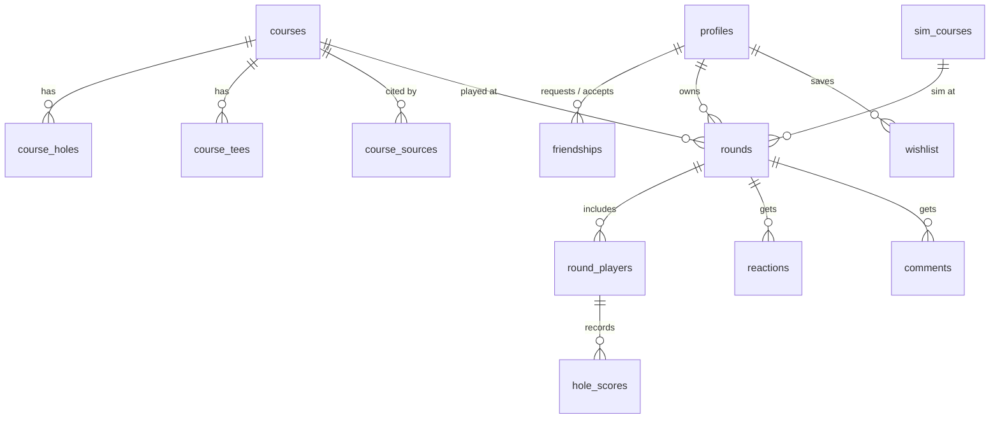

# Database plan (v0.1)

*Drafted: November 26, 2026 · Target: Supabase (Postgres + Auth + row-level security)*

**Status (2026-11-26):** live. The app signs in with email and reads/writes Supabase (`src/data/supabase-repository.ts`); without the `EXPO_PUBLIC_SUPABASE_*` env vars it falls back to an offline demo on bundled sample data.

- Migrations applied (in order): initial schema · explicit API grants (new Supabase projects don't auto-grant SQL-created tables) · rounds read policy fix (creating a round failed RLS because the policy looked the row up by id) · keep tags as guest names when an account is deleted (deleting a tagged user failed a check constraint).
- `npm run db:import-courses`: researched courses + sim courses (service-role key, local only).
- `npm run db:seed-test`: recreates the **test accounts** (all `@greenskeeper.test`): `golfer@` (you; password in `.env` as `TEST_ACCOUNT_PASSWORD`), four friends with rounds/reactions/comments, and Pat Green with a pending friend request. Sample data reaches the database only through these test accounts.
- Verified live as the test account: load, saving a round hole by hole, untouched stats staying null, reactions, comments, delete, friend accept/remove, search, and that you can't create a round owned by someone else.

The first migration is ready to run: [`supabase/migrations/20261126000000_initial_schema.sql`](../../supabase/migrations/20261126000000_initial_schema.sql). It was applied to a local Postgres 17 with Supabase's `auth` schema stubbed, and the access rules were tested with three users (see [Tested](#tested)).

---

## 1. What we store vs. what we derive

**Stored:** only what people enter, plus researched course facts.

| Stored | Why |
|---|---|
| Courses, holes, tees, sources | Researched reference data (see the `course-research` skill). Read-only for users. |
| Profiles, friendships | Who you are and who sees your rounds. |
| Rounds, players, hole scores | The source of truth for everything else. |
| Reactions, comments, wishlist | Social and personal state. |

**Derived in the app (not stored):** stats, handicap estimate, ball-marker tiers, collectibles, badges, feed "earned" chips, course leaderboards. The domain engines in `src/domain` already compute these from rounds, so the backend doesn't have to agree with the app about game rules, and tuning a rule (e.g. "Silver = break 90") never needs a data migration.

The cost: to show a friend's Trophy Room, the app loads that friend's rounds and computes it. That's fine at friend-group scale. When it isn't (big leagues, push notifications like "Mike earned a Gold marker"), add a server-side `earned_items` table filled by an Edge Function. Section 6 has the details.

---

## 2. Tables

### Reference data

| Table | Key columns | Notes |
|---|---|---|
| `courses` | `id` (slug), name, city, state, county, region, biome, access, lat/lng, website, architect, year_opened, description, `verification_status`, `verification_notes[]`, `checked_on`, `tags[]` | Mirrors `Course` in `src/domain/types.ts`. Name/city full-text index for search. |
| `course_holes` | (`course_id`, `number`), par, handicap | Stroke index is the men's index. |
| `course_tees` | (`course_id`, `id`), name, par, total_yards, `hole_yardages int[18]` or null, rating/slope for men and women, sort_order | Null yardages = "no trustworthy hole breakdown", same rule as today. |
| `course_sources` | course_id, name, url, license, checked_on | Every course cites its sources (ODbL attribution lives here). |
| `sim_courses` | id, name, platform, `holes jsonb` | Simulator layouts; a separate track. |

### People & social

| Table | Key columns | Notes |
|---|---|---|
| `profiles` | `id` = `auth.users.id`, username (unique, optional), display_name, tagline, avatar_url, home_state, home_course_id | Created automatically on sign-up by a trigger. |
| `friendships` | (`requester_id`, `addressee_id`), status `pending`/`accepted`, timestamps | One row per pair (a unique index blocks the reverse duplicate). Declining = deleting the row. |
| `reactions` | (`round_id`, `user_id`), emoji | One reaction per person per round, from the app's four emoji. |
| `comments` | id, round_id, user_id, body (1–500 chars), created_at, edited_at | Round owners can delete comments on their rounds. |
| `wishlist` | (`user_id`, `course_id`) | Bookmarked courses. |

### Rounds

| Table | Key columns | Notes |
|---|---|---|
| `rounds` | id (uuid), owner_id, kind `course`/`sim`, course_id **or** sim_course_id, tee_id, played_on, status `active`/`complete`, `hole_numbers[]`, visibility `friends`/`private`, competition_id | A check constraint enforces course vs. sim. (course_id, tee_id) must be a real tee. |
| `round_players` | id, round_id, profile_id **or** guest_name, is_owner | Replaces `Round.playerIds`. Friends are tagged by profile; non-users by name. |
| `hole_scores` | (`round_player_id`, `hole_number`), **strokes (required)**, putts, fairway, gir, penalties, chips, sand_shots | Every optional stat is `null` when not entered, never 0. Keyed by player, so multi-player score entry is already supported. |

**Group scoring** (migration `…000900_group_scoring.sql`): one phone keeps score for the group, but each player still gets **their own round** (`owner_id` = that player), so stats, handicap, collectibles and event results need no special cases. `rounds.scored_by` is the scorekeeper and `rounds.group_id` ties the group's rounds together. A scorekeeper can create a round only for an accepted friend, and can edit it (and its players and scores) **only while it's active**; once finished it belongs to the owner alone. The owner gets a push when someone starts keeping their score and when the round is finished.

---

## 3. Who can see what (row-level security)

| Data | Read | Write |
|---|---|---|
| Courses, tees, holes, sources, sim courses | Everyone, signed in or not | Import script only (service role) |
| Profiles | Any signed-in user (needed to find friends) | Yourself |
| Friendships | The two people in it | Send as yourself; the addressee accepts; either removes |
| Rounds, players, scores | Owner; players tagged on it; accepted friends **unless the round is private** | Owner only |
| Reactions, comments | Anyone who can see the round | As yourself, on rounds you can see. Owner can delete comments on their round |
| Wishlist | Yourself | Yourself |

Two helper functions do the checks: `are_friends(a, b)` and `can_view_round(round_id)`.

### Tested

Run against a local Postgres 17 with a stub `auth` schema:

- ✅ A friend sees nothing while the request is pending, then sees the round and its scores after accepting.
- ✅ A friend can react and comment, but can't edit the round or delete its scores (0 rows affected).
- ✅ A stranger sees no rounds or comments and can't comment; nobody can react as someone else.
- ✅ Setting a round to `private` hides it from friends.
- ✅ Signed-out visitors can read courses but not rounds.

---

## 4. Mapping to the app

The app already reads everything through the `Repository` interface (`src/data/repository.ts`), so the backend is a new `SupabaseRepository` with no screen rewrites.

| App today | Database |
|---|---|
| `Round.ownerId` (omitted = me) | `rounds.owner_id` |
| `Round.playerIds` | `round_players` |
| `Round.scores[playerId][i]` | `hole_scores` for that `round_player_id` (hole = `hole_numbers[i]`) |
| `Round.date` | `rounds.played_on` |
| `SocialState.reactions / comments` | `reactions`, `comments` |
| `wishlist` | `wishlist` |
| `friends: Player[]` | accepted `friendships` joined to `profiles` |
| Seed JSON (`courses.ct.json`) | Imported into the course tables by a script using the service-role key |

Things that stay in app config for now: tier rules, collectible sets per course and achievement definitions (`src/data/config`). They ship with the app version that understands them.

---

## 5. Your setup steps

1. **Create the project** at supabase.com (US East is closest to CT). Save the database password in your password manager.
2. **Run the migration:** paste the migration file into SQL Editor → Run, or with the CLI: `npx supabase link --project-ref <ref>` then `npx supabase db push`.
3. **Auth:** **email sign-in only** (decided 2026-11-26; no Apple or Google). It's on by default in Supabase. While testing, consider turning off **Confirm email** (Authentication → Sign In / Providers → Email) so new test accounts work without clicking a link; turn it back on before launch. Note: App Store rules only require Sign in with Apple when an app offers *third-party* social logins, so email-only is fine.
4. **Emails (before real users):** the app confirms sign-ups and resets passwords with a **code typed into the app**, not a link (links would need deep-link setup and break when the email is opened on a computer). In Authentication → Emails → Templates, make **Confirm signup** and **Reset password** show `{{ .Token }}` (e.g. "Your Greens Keeper code is {{ .Token }}"). Also set up **custom SMTP** (Authentication → Emails → SMTP, e.g. Resend with a verified domain): Supabase's built-in sender only delivers to your team's addresses and is rate-limited.
5. **Keys:** `.env` (gitignored) holds `EXPO_PUBLIC_SUPABASE_URL` and `EXPO_PUBLIC_SUPABASE_PUBLISHABLE_KEY` (bundled into the app), plus `SUPABASE_SERVICE_ROLE_KEY` and `SUPABASE_DB_PASSWORD` (local scripts only; never `EXPO_PUBLIC_`).
6. **Tell me when it's up.** I'll then write the course import script, the `SupabaseRepository`, sign-in screens and friend requests.

`@supabase/supabase-js` is already in `package.json`. `@supabase/ssr` is for server-rendered web apps and isn't needed for Expo. Before wiring the client, check Supabase's current Expo quickstart for the session-storage setup (AsyncStorage) it recommends.

---

## 6. Later (not in this migration)

| Feature | Likely shape |
|---|---|
| ~~Leagues & tournaments~~ | **Done (2026-11-26):** `events`, `event_members`, `event_rounds`, `event_matches`, `rounds.event_round_id`; members of an event see each other's linked rounds; join by code via `join_event()` |
| Server-side earned items | `earned_items (profile_id, course_id, item_id, tier, round_id, earned_on)`, written by an Edge Function when a round completes; powers notifications and cheap Trophy Rooms |
| Notifications | `notifications (recipient_id, kind, payload, read_at)` + Expo push tokens table |
| Live rounds | Supabase Realtime on `hole_scores` for rounds marked live |
| Course search near me | PostGIS `geography(point)` column + distance index |
| Photos & avatars | Supabase Storage buckets with matching RLS |
| Course data from a licensed provider | Same course tables; `course_sources` records the provider and license |

---

## 7. Open questions

1. **Default round visibility:** `friends` (current) or `private` until you share?
2. **Usernames:** required at sign-up (for friend search), or optional with search by name/email?
3. **Guests:** do we want guest players on the scorecard now, or only friends?
4. ~~Account deletion~~ **Decided:** deleting a user removes their rounds; their tags on other people's rounds become guest names (migration `…000300`).
5. **ODbL share-alike:** does serving OpenGolfAPI-derived course data from our database count as publishing a derived database? Decide before public launch.
